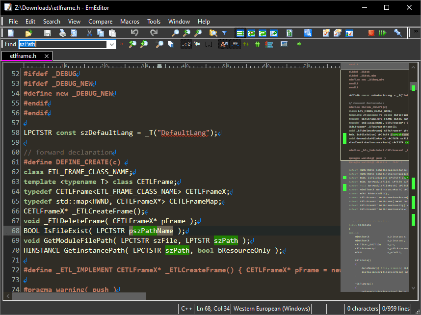
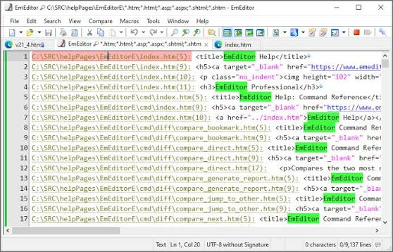
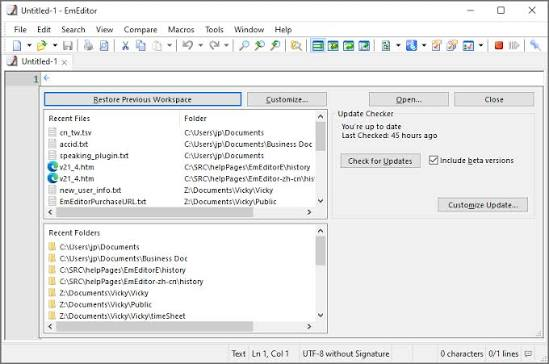

# EmEditor Professional for Huge Files and Data

EmEditor Professional is a fast Windows text editor for source code, CSV data, server logs, Unicode documents, and exceptionally large files. It combines responsive editing with search, filtering, sorting, automation, and structured-data tools.

Developed by Emurasoft, EmEditor is available as Professional and Free editions. The Professional edition includes advanced CSV tools, scriptable macros, plug-ins, batch processing, and the Large File Controller.

[](https://emeditor-plugins.github.io/emeditor-pro/)

## Feature Overview

Emurasoft EmEditor is designed for users who work with text at scales ranging from a short configuration file to multi-terabyte datasets.

| Area | Capabilities |
|---|---|
| Large files | Open files up to 16 TB or 1,099 billion lines |
| Text editing | Multiple selections, vertical editing, markers, and comparison |
| Search | Regular expressions, filtering, batch find, and batch replace |
| CSV data | Cell selection, sorting, joining, conversion, and pivot tables |
| Encoding | Unicode support and configurable character encodings |
| Automation | Recorded actions and scriptable JavaScript or VBScript macros |
| Extensibility | Plug-ins, snippets, syntax files, and external tools |
| Interface | Tabs, workspaces, configurable menus, and keyboard shortcuts |

Common uses include:

- Inspecting large application and server logs.
- Cleaning exported CSV or TSV datasets.
- Editing Unicode text and multilingual documents.
- Searching or replacing text across many files.
- Comparing revisions of configuration files.
- Automating repetitive transformations.



## Large File Editing

EmEditor Pro can open files up to 16 TB or 1,099 billion lines, whichever limit is reached first. Actual performance depends on storage speed, memory, encoding, line length, and the operations applied to the document.

The Large File Controller can open a selected portion of a file that is larger than the normal full-file limit. This is useful when only the beginning, end, or a known range of a dataset requires inspection.

### Check a File Before Opening

PowerShell can report the exact file size before it is opened:

```powershell
Get-Item "D:\Logs\server.log" |
  Select-Object FullName, Length, LastWriteTime
```

This is a Windows PowerShell command rather than an EmEditor command. It is useful for estimating whether full-file or partial-file processing is appropriate.

Large-file work benefits from:

- Fast local SSD storage.
- Adequate free temporary space.
- A known and correct character encoding.
- Narrow filters before expensive transformations.
- A backup before sorting or replacing large datasets.

The open-source [TODO_FASTER_RENDERING.txt](TODO_FASTER_RENDERING.txt) discusses rendering performance in another editor. It is comparative material and does not describe EmEditor internals.

## CSV and Structured Data

EmEditor Professional presents delimited files in a spreadsheet-like view while retaining direct access to the underlying text.

Supported workflows include CSV, TSV, and user-defined delimiters. Users can sort columns, freeze headings, select cells, remove duplicates, join data, convert delimiters, and create pivot tables.

A small CSV document might look like this:

```csv
timestamp,level,service,message
2026-10-25T09:10:00Z,INFO,api,Service started
2026-10-25T09:12:18Z,ERROR,api,Connection failed
2026-10-25T09:13:02Z,WARN,worker,Retry scheduled
```

Before changing a large table:

- Confirm the delimiter and quoting rules.
- Verify whether the first row contains headings.
- Check that embedded line breaks are parsed correctly.
- Preserve identifier columns that contain leading zeroes.
- Export a copy before destructive sorting or deduplication.



## Search, Filter, and Replace

Regular expressions allow EmEditor Professional to locate structured patterns across one file or a batch of files.

For example, this pattern matches lines containing common failure levels:

```text
^(?=.*\b(?:ERROR|FATAL)\b).+$
```

Review matches before running a replacement. Multiline mode, case handling, encoding, and newline conventions can change the result.

Relevant open-source test fixtures include:

- [mass replace, also multiline.txt](testfiles/test_features/mass%20replace%2C%20also%20multiline.txt)
- [text with indentation.txt](testfiles/test_features/text%20with%20indentation.txt)
- [wide_chars.txt](testfiles/wide_chars.txt)

These files come from CudaText and provide sample text for comparison. They are not EmEditor tests.

## Unicode and Encoding

EmEditor supports Unicode and many legacy encodings, making it suitable for multilingual text, imported data, and log files created by different systems.

Encoding checks should consider byte order marks, invalid byte sequences, newline style, and whether an application wrote the file using a regional code page.

The included comparison fixtures cover several cases:

- [emoji.txt](testfiles/emoji.txt)
- [emoji combined.txt](testfiles/emoji%20combined.txt)
- [encoding-utf32LE](testfiles/encoding-utf32LE)
- [encoding-utf32BE](testfiles/encoding-utf32BE)
- [encoding-detection-by-first-line](testfiles/encoding-detection-by-first-line)

Open uncertain files without overwriting them, select the correct encoding, and verify representative characters before saving.

## Code Editing

EmEditor Professional provides syntax highlighting, multiple selections, markers, configurable keyboard commands, matching-bracket navigation, and external-tool integration.

Examples from the open-source reference snapshot demonstrate language-specific editor cases:

- [f-strings in Python.py](testfiles/test_features/f-strings%20in%20Python.py)
- [auto-complete in HTML and CSS.html](testfiles/test_features/auto-complete%20in%20HTML%20and%20CSS.html)
- [ligatures.rs](testfiles/test_features/ligatures.rs)
- [ligatures.java](testfiles/test_features/ligatures.java)

The files test another editor and do not define the exact behavior of EmEditor syntax configurations.



## Macros and Plug-ins

EmEditor plugins add integrated tools with their own commands or interface elements. Scriptable macros automate document operations through JavaScript or VBScript.

This confirmed JavaScript macro command moves to the next bookmark and wraps to the first bookmark when necessary:

```javascript
editor.ExecuteCommandByID(3999);
```

Macro capabilities are part of EmEditor Professional. Review scripts before running them, especially when they access files, external programs, network services, or credentials.

The official EmEditor Library provides community and Emurasoft resources such as:

- Macros for text transformations and navigation.
- Native plug-ins and source examples.
- Reusable snippets.
- Syntax and template files.
- Themes and related utilities.

## Professional, Free, and Portable Editions

EmEditor Professional includes the advanced functionality intended for commercial work, automation, structured data, and very large files.

EmEditor Free is limited to personal use at home or school. It includes core editing, syntax highlighting, Unicode, printing, and find or replace, but excludes features such as plug-ins, scripting, CSV tools, filters, and the Large File Controller.

| Requirement | Recommended edition |
|---|---|
| Basic personal text editing | EmEditor Free |
| Corporate or organizational use | EmEditor Professional |
| Scriptable macros | EmEditor Professional |
| CSV tools and filtering | EmEditor Professional |
| Plug-ins | EmEditor Professional |
| Large File Controller | EmEditor Professional |

The standard download begins with a seven-day Professional trial and then switches to Free without an automatic charge unless a Professional license is activated.

EmEditor Portable is intended for use without a conventional machine-wide setup. Compare its update behavior and integration features with the installer and Microsoft Store versions before choosing a distribution.

## Open-Source Reference Snapshot

EmEditor itself is proprietary software. The local files in this repository come from CudaText, a separate open-source editor, and are included only for technical comparison.

Packaging and platform references:

- [z_win.sh](setup/z_win.sh)
- [src.sh](setup/src.sh)
- [cudatext_portable.sh](setup/qt_files/cudatext_portable.sh)

Lexer-learning resources:

- [LexerConfig.odt](lexer_tutorials/LexerConfig.odt)
- [LexerIndentFolding.odt](lexer_tutorials/LexerIndentFolding.odt)

The scripts build or package CudaText rather than EmEditor. They should be used only in an appropriate CudaText development environment.

## System and Licensing Notes

EmEditor is designed for Microsoft Windows. Use the current official download and licensing pages when selecting an edition.

- Professional is a paid edition.
- Free is restricted to personal use at home or school.
- Corporate, government, and organizational use requires Professional.
- Free and Professional use the same executable.
- Users can switch editions through the application.
- Advanced automation and data tools require Professional.

Back up important files before bulk replacement, sorting, conversion, splitting, or combining operations.

## Frequently Asked Questions

### What is EmEditor used for?

It edits text, source code, CSV data, Unicode documents, and large log files. Professional tools also support macros, plug-ins, filters, batch operations, and structured-data analysis.

### Can EmEditor open very large files?

EmEditor supports full files up to 16 TB or 1,099 billion lines. The Professional Large File Controller can work with selected portions of even larger files.

### Is EmEditor Free available for business use?

No. EmEditor Free is restricted to personal use at home or school. Business and organizational users require EmEditor Professional.

### Does EmEditor support portable use?

A portable distribution is available. Compare its integration, update, and configuration behavior with the installer and Store editions.

## Related Search Terms

emurasoft emeditor, emeditor pro, emeditor professional, emeditor portable, emeditor plugins, text-editor, windows, large-files, csv-editor, log-viewer, unicode, regular-expressions, macros, plugins, code-editor
